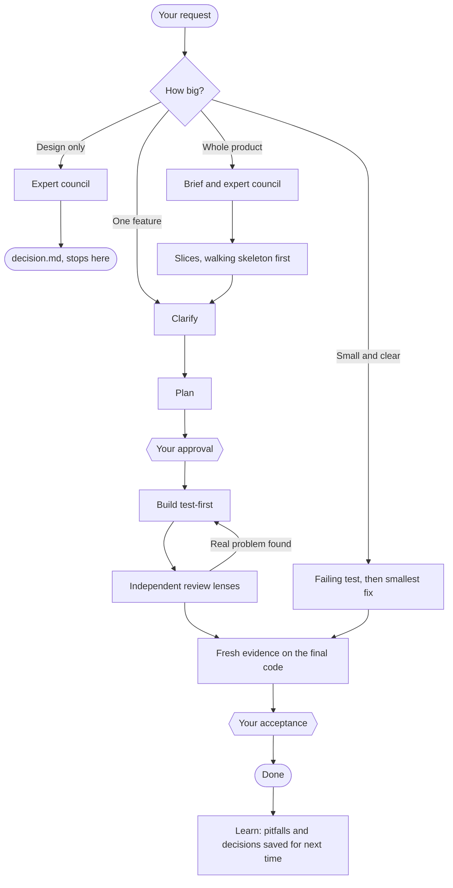
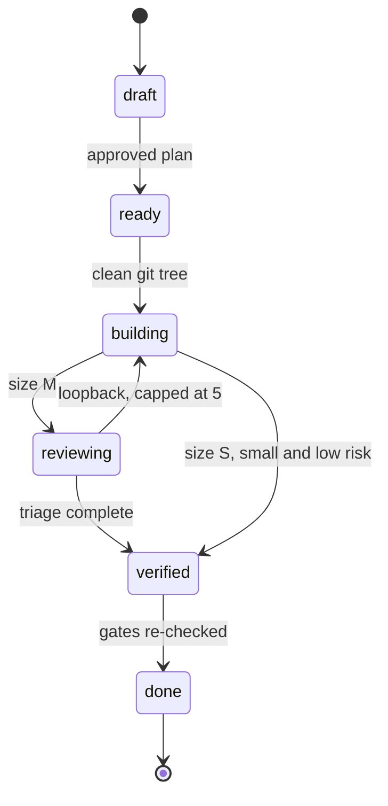
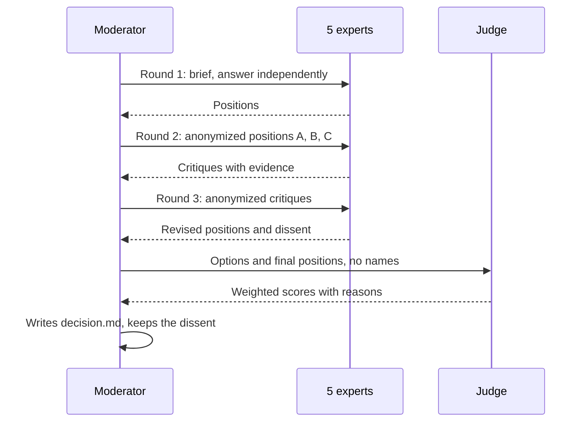

<p align="center">
  
</p>

<h1 align="center">Shipwright</h1>

<p align="center"><strong>From intent to verified, reviewed code.</strong><br>
A Claude Code plugin where a script, not a promise, decides when work is done.</p>

<p align="center">
  
  
  
  
  
  
</p>

<p align="center">
  <a href="#install"><b>Install</b></a> ·
  <a href="#see-it-work">See it work</a> ·
  <a href="#how-work-flows">How work flows</a> ·
  <a href="#what-the-gates-refuse">The gates</a> ·
  <a href="#expert-council">Council</a> ·
  <a href="#guide-explorer">Guide explorer</a> ·
  <a href="#measured-results">Results</a> ·
  <a href="#faq">FAQ</a>
</p>

---

## Install

```text
/plugin install shipwright --marketplace faizankhan789/Shipwright
```

Run that inside Claude Code, restart it, then ask for something to be built or fixed. Shipwright starts on its own.

> [!NOTE]
> You need Claude Code 2.1.275+ and Python 3.9+. Git is optional but recommended. On Windows, Claude Code also needs Git Bash to run the plugin's hooks.

<details>
<summary><b>Other ways to install, update or remove it</b></summary>

**From your terminal**

```bash
claude plugin install shipwright --marketplace faizankhan789/Shipwright
```

**On older Claude Code versions**

```bash
claude plugin marketplace add faizankhan789/Shipwright
claude plugin install shipwright@shipwright
```

**From a local clone**

```bash
git clone https://github.com/faizankhan789/Shipwright.git
claude plugin marketplace add ./Shipwright
claude plugin install shipwright@shipwright
```

**Check it worked:** `claude plugin list` should show `shipwright@shipwright` as enabled.

**Update**

```bash
claude plugin marketplace update shipwright
claude plugin update shipwright@shipwright
```

**Uninstall**

```bash
claude plugin uninstall shipwright@shipwright
claude plugin marketplace remove shipwright
```

</details>

> [!TIP]
> Shipwright bundles its own design, debugging, testing and process guides. Disable other plugins, skills or hooks that cover the same ground: in testing, hooks that forced other skills first cut Shipwright's trigger rate from about 97% to about 64%.

## See it work

<p align="center">
  
</p>

The first passing test isn't enough. Shipwright refuses the fix until there's proof the test failed first and a stated root cause.

**Pick a request to see what happens:**

<details>
<summary><b>"Fix the off-by-one in pagination"</b> · small fix</summary>

1. Reproduces the bug and states a root-cause hypothesis
2. Writes a test that fails for the right reason
3. Makes the smallest fix
4. Runs the edge-case review and records fresh evidence
5. Marks it done

</details>

<details>
<summary><b>"Add CSV export to reports"</b> · one feature</summary>

1. Reads the code before asking anything
2. Asks one numbered round of questions, only what the code can't answer
3. Writes a plan with testable acceptance criteria
4. **Waits for your approval**, which freezes the intent
5. Builds it test-first
6. Runs up to seven independent reviewers, and every finding gets a logged verdict
7. Verifies against the final code, then **waits for you to accept**

</details>

<details>
<summary><b>"Build a habit-tracking app"</b> · whole product</summary>

1. Writes a one-page brief with numbered requirements
2. Convenes the expert council on the hard-to-reverse decisions
3. Records the architecture and decisions
4. Slices the work, walking skeleton first
5. **Waits for your approval**
6. Runs each slice as its own feature
7. Reviews the whole product once at the end, including the seams between slices

</details>

<details>
<summary><b>"Design the architecture for a multi-tenant billing system"</b> · design only</summary>

1. Analyzes the problem and writes measurable quality scenarios
2. Runs a three-round expert debate
3. An independent judge scores the options
4. Delivers `decision.md`: options, trade-offs, architecture, risks and dissent
5. **Stops there** until you ask to build

</details>

<details>
<summary><b>"Pick up where we left off"</b> · new session</summary>

Plans, decisions and evidence live in `.shipwright/` in your project, so any session can see each item's status, what happened last, and the next step.

</details>

<details>
<summary><b>"...in auto mode"</b> · unattended</summary>

No checkpoints. Judgment calls are logged as rulings the human can overturn. A real gap in intent blocks that item, and work moves to the next one.

</details>

## How work flows



## What the gates refuse

This is what separates Shipwright from a list of good intentions. `shipwright.py` holds each item's status and refuses unsafe moves.



<details>
<summary><b>Every check, gate by gate</b></summary>

| To reach | Shipwright requires |
|---|---|
| `ready` | Named approver for features, no placeholders or open questions, Given/When/Then criteria, a file path on every task, a planned check, a risk score. Intent, criteria, size, type and checks are then hashed, so later edits are caught. |
| `building` | A current approval and a clean git tree. Every re-entry counts toward a cap of 5. |
| `verified` | Every planned check passing against the current code. A failing test recorded first, using the plan's own test runner. A real hypothesis for bug fixes. No files changed outside the plan. |
| `verified` (UI) | A design guide consulted, a passing design check on every changed UI file, and a screenshot. |
| `verified` (feature) | A row from each required reviewer, and every real finding fixed or deferred. |
| `done` | The same gates, checked again. |

Evidence is signed, hash-chained and tied to a fingerprint of your code. Change the code after a passing run and that run no longer counts. A hook also blocks hand-edits to evidence and gate fields.

</details>

## Expert council

For decisions that are hard to reverse, five senior personas debate in three rounds, then an independent judge scores the options. Research shows debate improves answers but fails through agreement, so the protocol is built to prevent that.



<details>
<summary><b>Meet the council</b></summary>

| Agent | Brings |
|---|---|
| Principal Solution Architect | Boundaries, data, contracts, trade-offs, Well-Architected review |
| Full-Stack AI Engineer | Buildability, AI pattern, evals, guardrails, cost |
| Senior Staff Engineer | Simplicity, correctness, testability, delivery |
| Senior Product and UI Designer | Users, flows, every UI state, accessibility |
| Red Team | Pre-mortem, attacks on security, reliability, cost and assumptions |
| Council Judge | Scores options blind against weighted quality scenarios; doesn't debate |

</details>

<details>
<summary><b>Why it's built this way</b></summary>

| Finding | What the protocol does |
|---|---|
| Debate improves reasoning, with gains levelling off after about 3 rounds ([Du et al.](https://arxiv.org/abs/2305.14325)) | Independent first, then exactly 3 rounds |
| Debates fail through sycophancy and conformity ([1](https://arxiv.org/abs/2509.23055), [2](https://arxiv.org/html/2510.07517v4)) | Anonymous positions, change only with evidence, a dedicated red team, recorded dissent |
| Weaker agents drag the group down ([paper](https://arxiv.org/abs/2509.05396v2)) | Every member runs on the strongest model |
| Multi-agent work costs about 15× the tokens ([Anthropic](https://www.anthropic.com/engineering/multi-agent-research-system)) | Convened only for decisions worth it |

</details>

<details>
<summary><b>All 17 internal agents</b></summary>

| Agent | Role |
|---|---|
| `shipwright-principal-architect`, `shipwright-ai-engineer`, `shipwright-staff-engineer`, `shipwright-design-lead`, `shipwright-red-team` | Council members |
| `shipwright-council-judge` | Scores the options |
| `shipwright-investigator` | Read-only code search; returns a plan-ready summary |
| `shipwright-implementer` | Builds one approved plan test-first |
| `shipwright-ui-designer` | Builds UI with the design guides; verifies in a browser |
| `shipwright-debugger` | Four-phase root-cause analysis with a failing repro test |
| `shipwright-blind-reviewer`, `shipwright-edge-case-reviewer`, `shipwright-verification-gap-reviewer`, `shipwright-intent-reviewer`, `shipwright-rules-reviewer`, `shipwright-ui-reviewer`, `shipwright-security-reviewer` | Context-free, read-only review lenses |

</details>

## Guide explorer

173 specialist guides ship inside the plugin. They never trigger on their own and cost nothing until a phase opens one. Claude picks by the meaning of your request, and a keyword shortlist helps. Open a section to browse it:

<details>
<summary><b>UI and design</b> · 31 guides · pages, app screens, critique, polish, motion, mobile UI, Figma, accessibility</summary>

`a11y-audit` · `animate` · `animate-expo` · `animation-performance` · `animation-vocabulary` · `art-direction` · `ask-sonner` · `break-ui` · `design-craft` · `figma-code-connect` · `figma-code-workflows` · `figma-create-new-file` · `figma-design-to-code` · `figma-generate-design` · `figma-generate-library` · `figma-implement-motion` · `figma-spec` · `figma-swiftui` · `figma-use` · `figma-use-motion` · `find-animation-opportunities` · `fluid-motion-design` · `frontend-design` · `improve-animations` · `interface-design` · `mobile-app-ui-design` · `mobile-native` · `pick-ui-library` · `prototype` · `review-animations` · `ui-polish`

</details>

<details>
<summary><b>Coding practice</b> · 26 guides · tests, plans, reviews, refactors, releases, flags, migrations, onboarding</summary>

`brainstorming` · `changelog-generator` · `code-tour` · `codebase-onboarding` · `dispatching-parallel-agents` · `executing-plans` · `feature-flags-architect` · `finishing-a-development-branch` · `git-worktree-manager` · `migration-architect` · `monorepo-navigator` · `pr-review-expert` · `receiving-code-review` · `release-manager` · `requesting-code-review` · `self-eval` · `ship-gate` · `spec-driven-workflow` · `subagent-driven-development` · `surgical-change-guidelines` · `surgical-coding` · `tech-debt-tracker` · `test-driven-development` · `using-git-worktrees` · `verification-before-completion` · `writing-plans`

</details>

<details>
<summary><b>Debugging</b> · 11 guides · bugs, crashes, performance, memory, browser and Android issues</summary>

`a11y-debugging` · `android-debugging` · `chrome-devtools` · `chrome-devtools-cli` · `cookie-debugging` · `debug-optimize-lcp` · `focused-fix` · `memory-leak-debugging` · `performance-profiler` · `systematic-debugging` · `troubleshooting`

</details>

<details>
<summary><b>Testing</b> · 5 guides · API suites, browser end-to-end, screenshots, chaos and resilience</summary>

`android-testing` · `api-test-suite-builder` · `browser-automation` · `chaos-engineering` · `full-page-screenshot`

</details>

<details>
<summary><b>Security</b> · 13 guides · auth, OWASP, secrets, dependencies, pentesting</summary>

`api-security-testing` · `application-security-testing` · `ci-security-scanning-with-strix` · `dependency-auditor` · `env-secrets-manager` · `find-security-vulnerabilities-in-code` · `fix-security-vulnerabilities-with-strix` · `managed-pentesting-with-strix` · `owasp-top-10-testing` · `penetration-testing-with-strix` · `secrets-vault-manager` · `security-guidance` · `web-app-penetration-testing`

</details>

<details>
<summary><b>Backend and infrastructure</b> · 13 guides · APIs, databases, SQL, Docker, CI/CD, Kubernetes, Terraform, observability, MCP</summary>

`api-design-reviewer` · `ci-cd-pipeline-builder` · `database-designer` · `database-schema-designer` · `docker-development` · `helm-chart-builder` · `kubernetes-operator` · `mcp-server-builder` · `observability-designer` · `runbook-generator` · `slo-architect` · `sql-database-assistant` · `terraform-patterns`

</details>

<details>
<summary><b>Mobile</b> · 23 guides · Android, Kotlin, Compose, KMP, Swift and iOS</summary>

`android-data-layer` · `android-dev` · `android-development` · `android-expert` · `android-gradle-logic` · `android-retrofit` · `android-reverse-engineering` · `android-source-search` · `android-ux` · `coil-compose` · `compose` · `datastore` · `gradle-build-performance` · `kmp-boundaries` · `kmp-ktor` · `koin` · `kotlin-coroutines` · `kotlin-flows` · `modularization` · `paging` · `pdf-annotations` · `rxjava-migration` · `write-swift`

</details>

<details>
<summary><b>AI and ML</b> · 24 guides · RAG, agents, LLM cost, Hugging Face models and training</summary>

`agent-designer` · `agent-workflow-designer` · `hf-cli` · `hf-cloud-sagemaker-deployment-planner` · `hf-cloud-serving-image-selection` · `hf-mem` · `huggingface-best` · `huggingface-community-evals` · `huggingface-datasets` · `huggingface-gradio` · `huggingface-llm-trainer` · `huggingface-local-models` · `huggingface-lora-space-builder` · `huggingface-spaces` · `huggingface-tool-builder` · `huggingface-trackio` · `huggingface-vision-trainer` · `huggingface-zerogpu` · `llm-cost-optimizer` · `rag-architect` · `rag-implementation` · `train-sentence-transformers` · `transformers-js` · `trl-training`

</details>

<details>
<summary><b>Integrations</b> · 9 guides · Stripe payments and billing, web scraping</summary>

`connect-recommend` · `connect-required-verification-information` · `firecrawl` · `metronome` · `stripe-apps` · `stripe-best-practices` · `stripe-docs` · `stripe-projects` · `upgrade-stripe`

</details>

<details>
<summary><b>Product building</b> · 13 guides · research the best existing products, clone and launch</summary>

`build-from-best` · `replica-architect` · `replica-backend` · `replica-brand` · `replica-build` · `replica-deploy` · `replica-design` · `replica-diff` · `replica-entrepreneur` · `replica-launch` · `replica-recon` · `replica-test` · `reverse-engineer-anything`

</details>

<details>
<summary><b>Documents and media</b> · 5 guides · Word, PDF, PowerPoint and Excel files, codebase explainer videos</summary>

`codebase-flow-video` · `docx` · `pdf` · `pptx` · `xlsx`

These produce a file, so they skip plans and gates. Some need local tools: LibreOffice and Poppler for rendering and recalculation, and Node.js with ffmpeg for video.

</details>

## Measured results

| What was tested | Result |
|---|---|
| Fires when it should (live `claude` sessions, Shipwright alone) | 77 of 80 new prompts; the misses mention files absent from the empty test repo |
| Stays silent when it should | 40 of 40 |
| Right guide chosen (model, index and shortlist) | 132 of 136 |
| Every guide reachable by context | 173 of 173 |
| Test suite | 107 tests pass on macOS and Linux |

<details>
<summary><b>Platform support</b></summary>

| Platform | Design engine | Tested |
|---|---|---|
| macOS Apple Silicon | bundled | natively |
| macOS Intel | bundled | under Rosetta |
| Linux x64, ARM64 | bundled | full test suite in Docker |
| Windows x64 | bundled | engine and core workflow under Wine with Windows Python; not on a real Windows machine |

</details>

<details>
<summary><b>DORA delivery metrics</b></summary>

Record deploys and incidents, then measure delivery:

```bash
shipwright.py deploy --items 001,002
shipwright.py deploy-failed D003 --reason "500s on checkout"
shipwright.py deploy-recovered D003
shipwright.py metrics --days 30
```

It reports deployment frequency, change lead time, failed-deployment recovery time, change failure rate and rework rate, plus batch size, review loopbacks and escaped defects. See [`docs/DORA-VALIDATION.md`](docs/DORA-VALIDATION.md) for the mapping and a 30-day measurement plan. The design is validated against DORA; real project outcomes haven't been measured yet.

</details>

## FAQ

<details>
<summary><b>Will it slow down small tasks?</b></summary>

Small, clear work takes the short path: a short plan, a failing test, the fix, and evidence. Oversized or high-risk "small" items are pushed into review.

</details>

<details>
<summary><b>Does it trigger on every message?</b></summary>

No. Questions, explanations, read-only requests, exact one-line edits and slash commands get nothing. The always-on cost is about 1.8k tokens per session, mostly short descriptions.

</details>

<details>
<summary><b>Does it commit or push my code?</b></summary>

No. It commits only if you ask or your project's instructions say to, and it never pushes unless asked.

</details>

<details>
<summary><b>Where is my data stored?</b></summary>

In `.shipwright/` in your project. Commit it to share plans and decisions with your team, or add it to `.gitignore` to keep them local. The signing key is in `~/.config/shipwright/key`.

</details>

<details>
<summary><b>Can the gates be bypassed?</b></summary>

They stop mistakes and casual shortcuts, not a determined person with shell access. The signing key sits on your machine, and a named approver records who approved rather than proving it. Treat them as strong guardrails.

</details>

<details>
<summary><b>Does the UI check see everything?</b></summary>

For `.tsx` and `.jsx` it checks what's on each element: inline styles, Tailwind colour pairs, labels and alt text. Colours set in other components need a rendered page, so also scan a running dev server or built HTML.

</details>

<details>
<summary><b>Working on Shipwright itself</b></summary>

```bash
python3 tools/build_agents.py                            # regenerate agents after editing lenses or disciplines
python3 skills/shipwright/scripts/shipwright.py catalog  # regenerate catalog.json and INDEX.md
python3 -m unittest discover -s tests -v                 # 107 tests
claude plugin validate .                                 # manifest check
python3 evals/run_triggers.py --mode isolated            # live trigger test
```

```
agents/              generated agents
hooks/               session, prompt, guard and design-check hooks
skills/shipwright/   SKILL.md, phases, disciplines, lenses, council, templates, scripts, library
evals/               labelled prompts and live tests
docs/                DORA validation
tests/               test suite
```

</details>

## License

Shipwright is licensed under the **Shipwright License** (see [LICENSE](LICENSE)). The four document guides (`docx`, `pdf`, `pptx`, `xlsx`) stay under Apache-2.0; see [THIRD-PARTY-NOTICES.md](THIRD-PARTY-NOTICES.md).
