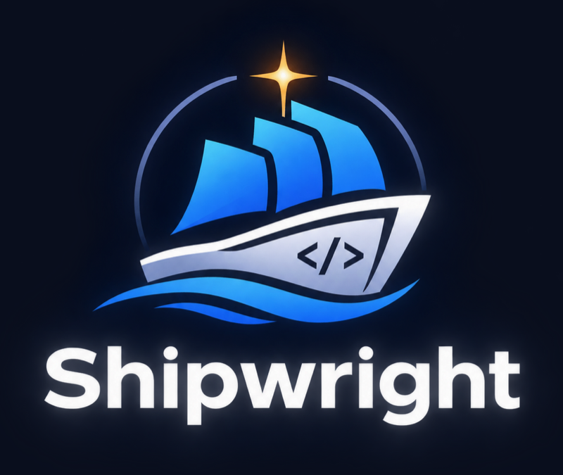

<p align="center">
  
</p>

<h1 align="center">Shipwright</h1>

<p align="center">A Claude Code plugin that takes work from intent to verified, reviewed code.</p>

One plugin that takes a feature, bug fix, refactor, or whole product from intent to verified,
reviewed code. It contains:
- **One skill** (`shipwright`) that owns the workflow.
- **17 internal agents:** a 5-member expert council that debates architecture decisions, an independent council judge, an implementer, a UI designer, a debugger, an investigator, and seven review lenses.
- **4 hooks:** resume reminder at session start, task recognition and routing on each prompt, a guard that blocks hand-edits to evidence, logs and plan gate fields, and a design check after each UI edit.
- **168 bundled specialist guides:** UI/design, coding, debugging, testing, security, mobile,
  backend/infra, AI/ML, integrations, and app-building. They load only when a phase needs them.

It brings together, in one workflow:
- **Planning:** plans and decisions on disk, frozen human-owned intent, an Open Questions gate, sized
  routing, ADRs and retrospectives.
- **Building:** test-first development, root-cause debugging, and evidence before "done".
- **Reviewing:** parallel context-free review with a verdict on every finding, and honest handling of
  feedback.
- **Orchestration and UI:** subagent orchestration, and a UI craft and accessibility floor.

The prose gates are backed by a stdlib-only script (`shipwright.py`) that refuses unsafe status changes.

## Install

**You need:** Claude Code 2.1.275 or later and Python 3.9+. Git is optional but recommended. On Windows, Claude
Code also needs Git Bash, which runs the plugin's hooks.

Inside Claude Code, run:

```text
/plugin install shipwright --marketplace faizankhan789/Shipwright
```

Or from your terminal:

```bash
claude plugin install shipwright --marketplace faizankhan789/Shipwright
```

Then restart Claude Code. On older versions, add the marketplace first:

```bash
claude plugin marketplace add faizankhan789/Shipwright
claude plugin install shipwright@shipwright
```

**Check it worked:** `claude plugin list` should show `shipwright@shipwright` as enabled. Then, in any
project, ask for something to be built or fixed, for example "Add a logout button". Shipwright starts on its own,
or you can say "use shipwright".

**Update:**

```bash
claude plugin marketplace update shipwright
claude plugin update shipwright@shipwright
```

**Uninstall:**

```bash
claude plugin uninstall shipwright@shipwright
claude plugin marketplace remove shipwright
```

**Install from a local clone** (for working on the plugin itself):

```bash
git clone https://github.com/faizankhan789/Shipwright.git
claude plugin marketplace add ./Shipwright
claude plugin install shipwright@shipwright
```

### Avoid overlapping skills

Shipwright bundles its own design, debugging, testing and process guides. Other plugins, skills or hooks that
trigger on the same requests will run alongside it and can stop it from firing. In testing, a setup with
session hooks that force other skills first cut Shipwright's trigger rate from about 97% to about 64%. For best
results, disable:
- standalone plugins and skills that cover the same ground (planning, TDD, debugging, design, UI)
- hooks that force-load other skills on session start or on each prompt

## How it works in practice

| You say | Shipwright does |
|---|---|
| "Fix the off-by-one in pagination" | Reproduce, failing test, fix, evidence, done |
| "Add CSV export to reports" | Investigate, one round of questions, plan, your approval, test-first build, review lenses, evidence, your acceptance |
| "Build a habit-tracking app" | Brief, expert council, architecture, vertical slices (walking skeleton first), each slice built and reviewed |
| "Design the architecture for X" | Problem analysis, council debate, `decision.md` solution design, then stops until you ask to build |
| "...in auto mode" | No checkpoints: decisions are logged, and real intent gaps block the item |
| (new session) | Resumes open work from `.shipwright/` in your project |

Work state lives in `.shipwright/` in your project. Commit it to share plans and decisions with your team, or
add it to `.gitignore` to keep them local.

## Layout

```
assets/                           logo and plugin icon
.claude-plugin/plugin.json        plugin manifest
.claude-plugin/marketplace.json   marketplace ("shipwright") listing this plugin
agents/                           17 agents, GENERATED from the skill's council/lens/discipline files
hooks/hooks.json                  SessionStart resume nudge, UserPromptSubmit router, PreToolUse guard, PostToolUse design check
hooks/design_check.py             runs the design check after each UI edit
hooks/py.sh                       finds a working Python on any OS (python3, python or py)
hooks/guard_state.py              blocks hand-edits to evidence, logs and plan gate fields
hooks/route_prompt.py             recognises tasks and routes them to the skill
skills/shipwright/
  SKILL.md                        entry: laws, sizing, phases, agents, library, modes, red flags
  phases/                         clarify, frame (L), council (L/D), plan, build, review, ship (+ learn)
  council/                        member rules + 5 expert personas
  disciplines/                    tdd, debugging, verification, feedback, ui
  lenses/                         blind, edge-case, verification-gap, intent-alignment, rules, ui-craft, security
  templates/                      plan-S, plan-M, brief, architecture, adr, context, council-brief, solution-design, implementer-prompt
  scripts/shipwright.py           state, gates, routing and design-check CLI (Python 3.9+, no dependencies)
  scripts/design_rules.py         JSX-aware UI checks for .tsx/.jsx
  library/
    ROUTING.md                    which guide for which situation + precedence rules
    INDEX.md                      section map, then every guide with its purpose (generated)
    catalog.json                  all 168 guides by section, used for routing (generated)
    routing.json                  curated routing rules
    shipwright_ui/ shipwright_coding/ shipwright_debugging/ shipwright_testing/ shipwright_security/
    shipwright_mobile/ shipwright_backend_infra/ shipwright_ai_ml/ shipwright_integrations/ shipwright_product/
tools/build_agents.py             regenerates agents/ from the skill files (--check verifies sync)
docs/DORA-VALIDATION.md           DORA metrics + AI Capabilities Model validation and measurement plan
tests/test_shipwright.py          97 tests: gates, evidence, council, routing, design check, hooks, portability, structure
evals/                            labelled prompts, live trigger test, model routing test
```

## Expert council (solution architecture)

For problem analysis and solution architecture (size L, design-only requests, and high-stakes
decisions), five senior personas debate the decision in three rounds:

1. independent positions
2. anonymized critique
3. revision with recorded dissent

The members are a **principal solution architect**, a **full-stack AI engineer**, a **senior
staff engineer**, a **senior product/UI designer**, and a **red team**. The moderator decides by
a weighted quality-scenario matrix, never by vote, and writes `decision.md`. That is the solution
design, with options, trade-off points, C4 views, a Well-Architected review, risks, and dissent.
`shipwright.py council check` enforces the full record.

The protocol is built on published findings:
- **Multi-agent debate improves reasoning and factuality,** with diminishing returns after about 3 rounds ([Du et al.](https://arxiv.org/abs/2305.14325)).
- **Debate fails through sycophancy and conformity** ([2509.23055](https://arxiv.org/abs/2509.23055), [2510.07517](https://arxiv.org/html/2510.07517v4)). Hence anonymized positions, "change only with evidence", a dedicated red team, and a central judge.
- **Weaker agents degrade debate** ([2509.05396](https://arxiv.org/abs/2509.05396v2)). All members run on the strongest model.
- **Multi-agent systems cost about 15× the tokens and suit high-value, parallel work** ([Anthropic](https://www.anthropic.com/engineering/multi-agent-research-system)). The council is only for decisions worth it.
- **Architecture method:** quality scenarios and trade-off points ([arc42](https://docs.arc42.org/tips/10-8/), [ATAM](https://cio-wiki.com/wiki/Architecture_Tradeoff_Analysis_Method_(ATAM))), real alternatives ([design docs/RFCs](https://blog.pragmaticengineer.com/rfcs-and-design-docs/)), and Well-Architected pillars ([Azure](https://learn.microsoft.com/en-gb/azure/well-architected), [Google Cloud](https://docs.cloud.google.com/architecture/framework)).

## DORA metrics

`shipwright.py deploy`, `deploy-failed` and `deploy-recovered` record production deploys and incidents in a signed log.
`shipwright.py metrics` then reports the five DORA metrics:
- **Throughput:** deployment frequency, change lead time, failed-deployment recovery time.
- **Instability:** change failure rate, deployment rework rate.

It also reports Shipwright's leading indicators: batch size, review loopbacks, and escaped defects.

`docs/DORA-VALIDATION.md` maps every DORA metric, the 2025 AI Capabilities Model, and the classic
capabilities to the plugin's mechanisms, with the gaps stated and a 30-day measurement plan.

## Platforms

Python 3.9+ is the only requirement. Git is optional: without it, Shipwright works but can't tie evidence to the code.

| Platform | Design engine | Tested |
|---|---|---|
| macOS Apple Silicon | bundled | natively |
| macOS Intel | bundled | under Rosetta |
| Linux x64, Linux ARM64 | bundled | full test suite in Docker |
| Windows x64 | bundled | engine and core workflow under Wine with Windows Python; not on a real Windows machine |

## Triggering and routing

- **Trigger:** the skill's description, plus a `UserPromptSubmit` hook (`hooks/route_prompt.py`, ~50 ms) that
  recognises build / fix / design / plan / resume requests and tells Claude to invoke `shipwright` first.
  Questions, explanations, read-only requests, dictated one-line edits and slash commands get nothing.
- **Routing to guides, by context:** the agent reads `library/INDEX.md` (a 10-section map, then one line per
  guide with "Use for" disambiguation) and picks by meaning. A keyword/BM25 engine over all 168 guides
  (`shipwright.py route`, `library/catalog.json` + `routing.json`) supplies a shortlist hint. Picks are logged
  with `route --use`, and UI work cannot reach `verified` without a logged design guide.
- **Measured** (`evals/`):
  - live `claude -p` runs: 89/90 and 117/120 prompts triggered correctly with Shipwright alone; the
    misses were prompts about files absent from the throwaway test repo;
  - model-led routing (index + shortlist): 132/136 across five prompt sets;
  - every guide is the top match for its own description (168/168).

  Re-run with `evals/run_triggers.py` and `evals/run_routing_model.py`.

## Agents

| Agent | Role |
|---|---|
| `shipwright-principal-architect`, `shipwright-ai-engineer`, `shipwright-staff-engineer`, `shipwright-design-lead`, `shipwright-red-team` | Council members (20+ years personas) debating in 3 anonymized rounds |
| `shipwright-council-judge` | Scores the options blind against weighted quality scenarios; does not debate |
| `shipwright-investigator` | Read-only code search; returns a plan-ready summary |
| `shipwright-implementer` | Builds one approved plan test-first; reports DONE / CONCERNS / NEEDS_CONTEXT / BLOCKED |
| `shipwright-ui-designer` | Builds UI with the bundled design guides; verifies in a browser |
| `shipwright-debugger` | Four-phase root-cause analysis; failing repro test |
| `shipwright-blind-reviewer`, `shipwright-edge-case-reviewer`, `shipwright-verification-gap-reviewer`, `shipwright-intent-reviewer`, `shipwright-rules-reviewer`, `shipwright-ui-reviewer`, `shipwright-security-reviewer` | Context-free, read-only review lenses |

The agents are generated from `skills/shipwright/lenses/*.md` and `disciplines/*.md`, so the
skill and the agents can never drift apart. After editing a lens or discipline, run
`python3 tools/build_agents.py`.

## Maintaining

```bash
python3 tools/build_agents.py                    # regenerate agents after editing lenses/disciplines
python3 skills/shipwright/scripts/shipwright.py catalog  # regenerate catalog.json and INDEX.md
python3 -m unittest discover -s tests -v         # 97 tests
claude plugin validate .                         # manifest check
```

## License

Shipwright is licensed under the **Shipwright License** (see [LICENSE](LICENSE)).

## Where the design came from

A rubric audit (12 dimensions, 0–10, with file and line evidence) compared two existing AI delivery
workflows, at 68% and 63%. Shipwright takes the best of each dimension. It targets the two lowest
scores, coherence and enforcement, with one workflow owner and script gates.

A trial run on a real feature (size M, auto mode) reached `done` with 4 review lenses and 18
triaged findings. Its 13 friction points have been fixed.

Those numbers are design targets plus one trial, not a delivery benchmark. Trigger and routing accuracy are
measured in `evals/`; DORA outcomes need real project data (see `docs/DORA-VALIDATION.md`).
